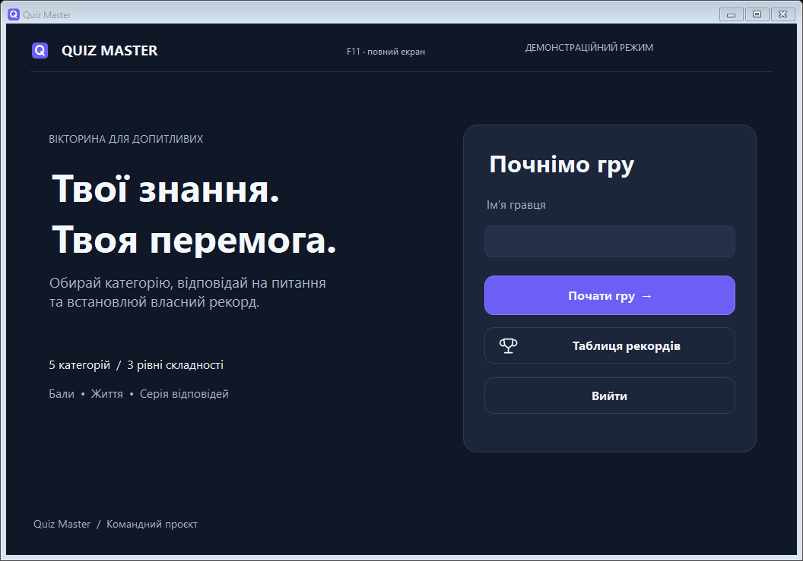
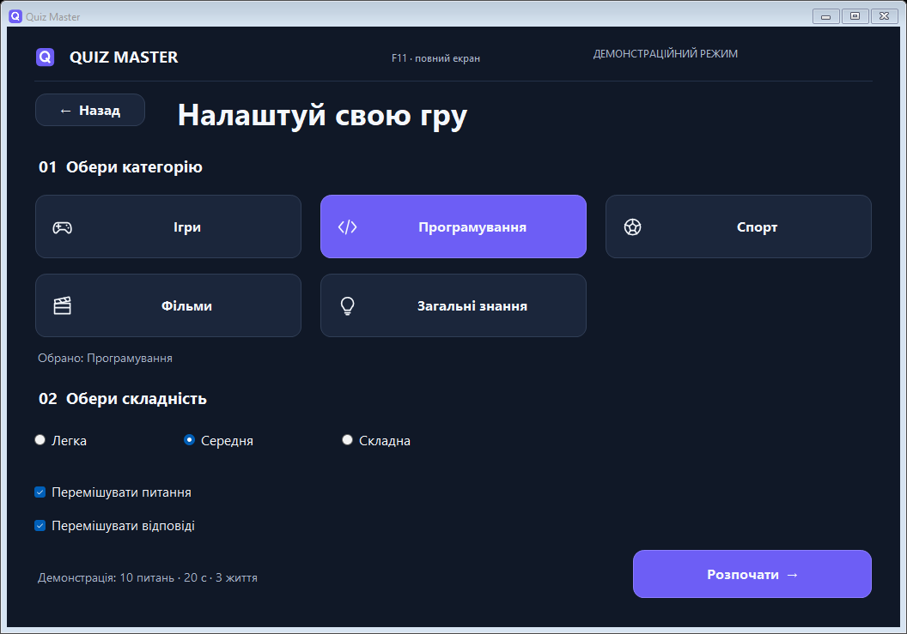
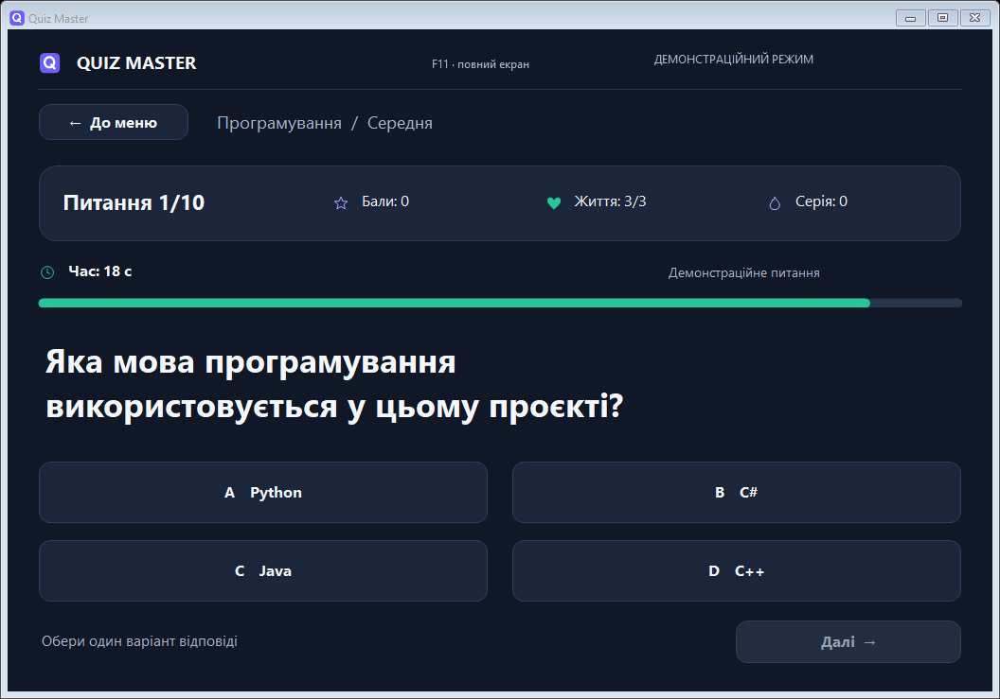
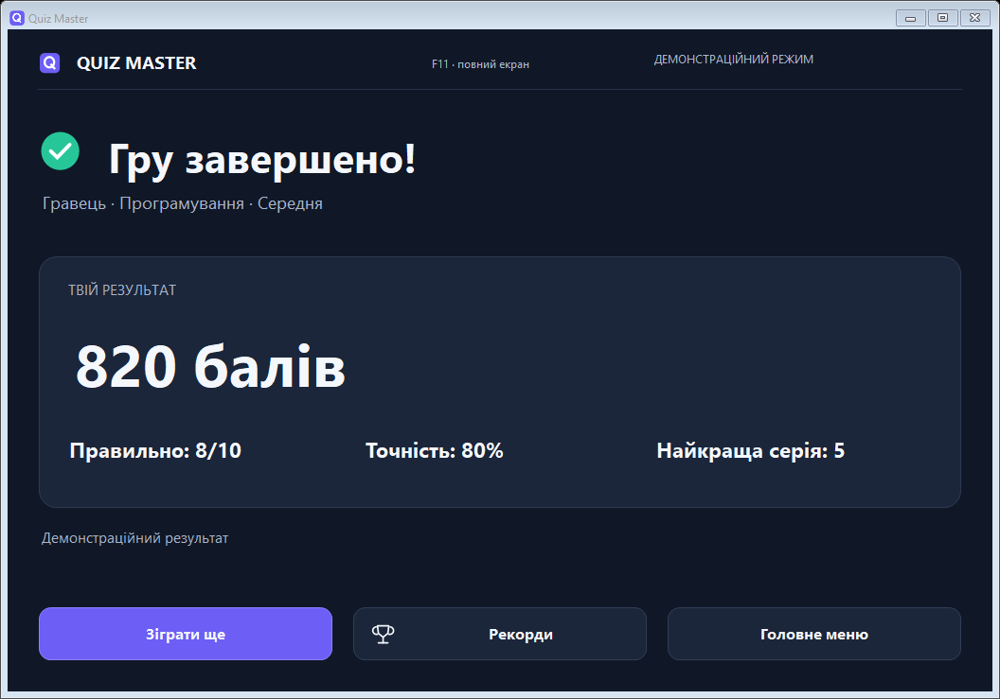
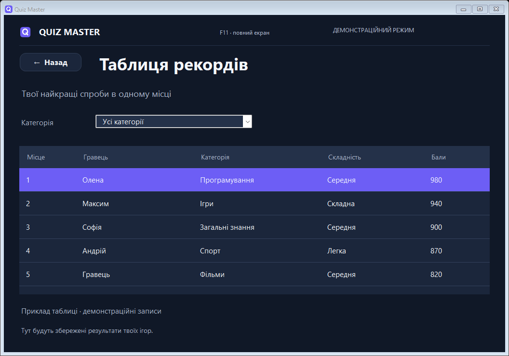

# Quiz Master — з чого почати роботу над UI

Робоче рішення: `C:\ХПФК\OKR\ЛР2\LR2_QuizMaster\LR2_QuizMaster.slnx`.
Проєкт: `LR2_QuizMaster`, C#, .NET 10, Windows Forms.

Підготовлено п’ять справжніх WinForms-форм у папці `Forms`. Кожна має `.cs` і `.Designer.cs`, використовує стандартні контроли та призначена для відкриття в дизайнері Visual Studio. Зображення в `Design/previews` отримані з цих форм.

Це заготовка інтерфейсу. Уже працюють ім’я гравця, вибір категорії та складності, прапорці перемішування, вибір відповіді, переходи між вікнами й фільтр демонстраційних рекордів. Таймер, перевірка відповідей, бали, життя, серії, перемішування та збереження рекордів ще не підключені. На екрані питання кнопка «Далі» після вибору відповіді відкриває приклад результату.

## Перший запуск

1. Відкрий `LR2_QuizMaster.slnx` у Visual Studio. Якщо рішення вже відкрите, онови список файлів або перевідкрий його.
2. У Solution Explorer відкрий `Forms`. Натисни правою кнопкою на `MainMenuForm.cs` → **View Designer / Переглянути конструктор**.
3. Запусти проєкт через **F5**. Введи ім’я → «Почати гру» → обери категорію і складність → «Розпочати» → обери відповідь → «Далі».
4. Перевір «Рекорди», «Зіграти ще», «Головне меню» та «Назад».
5. Для зміни вигляду обирай елемент у дизайнері та редагуй його у **Properties**. Робочу поведінку змінюй у `.cs`; `.Designer.cs` нехай надалі підтримує дизайнер.

Стартовий екран уже встановлено в `Program.cs`: `Application.Run(new MainMenuForm())`. Порожній `Form1` залишено в проєкті, він більше не є стартовим. Повторно створювати п’ять форм не потрібно.

## Візуальний стиль

| Властивість | Початкове значення |
| --- | --- |
| ClientSize кожної форми | 1040 × 700 |
| StartPosition | CenterScreen |
| FormBorderStyle | FixedSingle |
| MaximizeBox | False |
| AutoScaleMode | Dpi |
| Базовий шрифт | Segoe UI, 11 pt |
| Основний фон | `#101827` |
| Панелі й звичайні кнопки | `#1B263B` |
| Поля введення | `#243149` |
| Головна кнопка / обраний варіант | `#6D5EF5` |
| Основний текст | `#F4F7FC` |
| Допоміжний текст | `#AAB6CC` |
| Правильна відповідь — для наступного етапу | `#27C698` + текст «Правильно» |
| Помилка — для наступного етапу | `#E76C7B` + текст «Неправильно» |
| Відступ від краю | переважно 32 px |
| Кнопки | FlatStyle = Flat; FlatAppearance.BorderSize = 0 |

Системні рамки вікон, ComboBox, RadioButton, CheckBox та ProgressBar можуть трохи відрізнятися залежно від теми Windows. Розміри наведені для 100% масштабу, DPI-масштабування ввімкнене. У поточній версії форма має фіксований розмір; адаптація під зміну розміру — окреме покращення.

## 1. MainMenuForm — головне меню

Ліворуч назва й короткий опис. Праворуч блок початку гри.

| Що на екрані | Контрол у Toolbox | Name |
| --- | --- | --- |
| Блок початку гри | Panel | `pnlStart` |
| Назва та опис | Label | `lblBrand`, `lblTitle`, `lblIntro` |
| Ім’я гравця, максимум 20 символів | TextBox | `txtPlayerName` |
| Початок гри | Button | `btnStart` |
| Перегляд рекордів | Button | `btnLeaderboard` |
| Вихід із програми | Button | `btnExit` |

Що вже зроблено: перевірка порожнього імені, Enter для початку, відкриття налаштувань і рекордів.
Твій наступний крок: перевірити довгі імена, Tab-навігацію, вигляд поля введення й відступи.

## 2. GameSetupForm — категорія та складність

П’ять кнопок категорій, три RadioButton для складності, два CheckBox та кнопка початку.

| Що на екрані | Контрол | Name |
| --- | --- | --- |
| Назад | Button | `btnBack` |
| Ігри | Button | `btnGames` |
| Програмування | Button | `btnProgramming` |
| Спорт | Button | `btnSport` |
| Фільми | Button | `btnMovies` |
| Загальні знання | Button | `btnGeneral` |
| Текст поточного вибору | Label | `lblSelection` |
| Легка / Середня / Складна | RadioButton | `rdoEasy`, `rdoMedium`, `rdoHard` |
| Перемішувати питання | CheckBox | `chkShuffleQuestions` |
| Перемішувати відповіді | CheckBox | `chkShuffleAnswers` |
| Почати | Button | `btnStartQuiz` |

Що вже зроблено: підсвічування категорії, вибір рівня, передавання вибору у вікно гри. Прапорці зберігають вибір користувача, фактичне перемішування має виконувати backend.

**Пропозиції для макета:** три рівні «Легка / Середня / Складна», 10 питань, 20 секунд, 3 життя. Це ще не затверджені правила. Узгодь їх із командою, а потім отримуй параметри з backend.

## 3. QuizForm — основне вікно гри

Зверху категорія та складність, нижче прогрес і показники. Далі таймер, велике питання, чотири кнопки відповідей у два ряди та дія «Далі».

| Що на екрані | Контрол | Name |
| --- | --- | --- |
| Повернення в меню | Button | `btnExitQuiz` |
| Категорія й складність | Label | `lblCategory` |
| Панель показників | Panel | `pnlStats` |
| Питання 1/10 | Label | `lblProgress` |
| Бали | Label | `lblScore` |
| Життя | Label | `lblLives` |
| Серія відповідей | Label | `lblStreak` |
| Залишок часу | Label | `lblTimer` |
| Смуга часу | ProgressBar | `prgTime` |
| Текст питання | Label | `lblQuestion` |
| Чотири відповіді | Button | `btnAnswerA`, `btnAnswerB`, `btnAnswerC`, `btnAnswerD` |
| Результат вибору | Label | `lblFeedback` |
| Наступне питання | Button | `btnNextQuestion` |

Що вже зроблено: вибір однієї відповіді та активація «Далі». Фіолетовий колір означає лише **обрано**, а не правильність. Приклад питання однаковий для всіх категорій до підключення даних. Час 18 с, бали 0, життя 3/3 та серія 0 — статичні приклади.

Твій головний наступний крок: замінити демонстраційний перехід у `QuizForm.cs` на роботу з `Quiz`. Після відповіді слід заблокувати повторний вибір, отримати результат перевірки, показати повідомлення, оновити показники та лише потім дозволити перехід далі.

Потрібні стани для завершення UI:

- Правильно: зелений варіант + «Правильно» у `lblFeedback`.
- Неправильно: червоний обраний варіант, правильний варіант зелений, текст пояснення.
- Час вичерпано: усі відповіді заблоковані, «Час вичерпано».
- Питання закінчилися або життя вичерпані: перехід до результату.
- Довге питання / довга відповідь: текст переноситься без обрізання; за потреби збільшити блок або погодити обмеження довжини з backend.

Backend має бути єдиним джерелом часу, балів і життів. Якщо використаєш WinForms Timer для оновлення відображення, не дублюй у ньому незалежний відлік і правила втрати життя. При завершенні гри відписуйся від подій backend.

Під час перемішування відповіді передавай її стабільний ID або сам об’єкт відповіді. Літери A–D — позиції на екрані; вони не повинні визначати правильність.

## 4. ResultsForm — підсумок

Один великий показник балів, нижче правильні відповіді, точність та найкраща серія.

| Що на екрані | Контрол | Name |
| --- | --- | --- |
| Заголовок | Label | `lblHeading` |
| Гравець, категорія, складність | Label | `lblPlayer` |
| Блок підсумку | Panel | `pnlSummary` |
| Загальні бали | Label | `lblTotalScore` |
| Правильні відповіді | Label | `lblCorrect` |
| Точність | Label | `lblAccuracy` |
| Найкраща серія | Label | `lblBestStreak` |
| Повторна гра | Button | `btnPlayAgain` |
| Рекорди | Button | `btnLeaderboard` |
| Меню | Button | `btnMainMenu` |

Що вже зроблено: передавання імені та налаштувань, перехід у рекорди, повернення в меню. «Зіграти ще» повертає до вибору параметрів.
Твій наступний крок: отримувати справжній результат від backend. 820 балів, 8/10, 80% та серія 5 — приклад, формула балів із цих чисел не випливає. Узгодь, як рахувати точність при достроковому завершенні.

## 5. LeaderboardForm — таблиця рекордів

Таблиця на всю ширину, зверху фільтр категорії. Для першої версії не потрібні реєстрація та серверний рейтинг.

| Що на екрані | Контрол | Name |
| --- | --- | --- |
| Назад | Button | `btnBack` |
| Фільтр категорії | ComboBox | `cmbCategory` |
| Таблиця | DataGridView | `dgvLeaderboard` |
| Колонки | DataGridViewTextBoxColumn | `colRank`, `colPlayer`, `colCategory`, `colDifficulty`, `colScore` |
| Порожній стан | Label | `lblEmptyState` |

Що вже зроблено: таблиця з п’ятьма демонстраційними записами та фільтрація. Записи ще не зберігаються. Наступний крок: отримувати список результатів із погодженого сервісу, показувати порожній стан за відсутності записів і визначити сортування разом із командою. Не порівнюй результати різних рівнів як рівнозначні без узгоджених правил.

## Що тобі створювати далі

1. **Спочатку перевір усі п’ять форм у дизайнері.** Вони вже створені; не додавай дублікати. Узгодь з командою розташування, текст, кольори та потрібні показники.
2. **Створи папку `Assets`**, коли матимеш іконки або логотип. Для першої версії вони необов’язкові. Додавай картинки через ресурси проєкту, без абсолютних шляхів до файлів на твоєму ПК.
3. **Погодь з backend спосіб взаємодії.** Потрібні дані поточного питання, варіанти зі стабільними ID, категорія, складність, номер і загальна кількість питань, час, бали, життя, серія, результат перевірки та підсумок. Класи `Question`, `Quiz`, `Category` створює backend-розробник.
4. **У `QuizForm.cs` додай методи відображення** на кшталт `DisplayQuestion`, `UpdateStatus`, `ShowAnswerFeedback`. Назви — пропозиція; параметри виберіть після узгодження моделей. Ці методи мають відображати отримані дані.
5. **Додай сервіс рекордів у погоджену папку `Services`** або підключи готовий сервіс команди. Модель запису й спосіб збереження спочатку узгодь. Локальний JSON — лише можливий варіант, не затверджена вимога.
6. **Передай тестувальнику сценарій:** порожнє ім’я, усі категорії, кожна складність, перемішування, правильна й неправильна відповідь, подвійний клік, таймаут, останнє життя, повторна гра, повернення в меню, порожній рейтинг, запуск при 100% / 125% / 150% масштабі Windows.

Найкраща перша задача для тебе: запусти проєкт, відкрий `MainMenuForm` у конструкторі й доведи головне меню до узгодженого вигляду. Після цього переходь до `GameSetupForm`, а основний обсяг інтеграції роби в `QuizForm`.

## Порядок вікон

`MainMenuForm → GameSetupForm → QuizForm → ResultsForm`

`MainMenuForm → LeaderboardForm → назад`

`ResultsForm → LeaderboardForm → назад до результату`

`ResultsForm → Зіграти ще → GameSetupForm`

## Збережені файли

- `Forms/*.cs` — конструктори, вибір параметрів, навігація та місця підключення backend.
- `Forms/*.Designer.cs` — розташування, стиль і назви стандартних контролів.
- `Design/previews/*.png` — зображення кожного вікна.
- `Design/START_HERE.md` — ця інструкція.
- `Design/backup/Program.cs.original` — попередня точка входу до зміни стартового вікна.

Canva: [Open generated image](https://www.canva.com/M/MAHZZOVfDYM?utm_source=OC-AaBlKrqBJJNF&utm_campaign=agent_connector_create_image_asset_opened). Згенероване зображення — загальна концепція; точним орієнтиром для WinForms є п’ять PNG з реальних форм.
